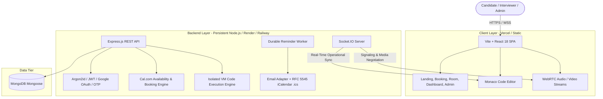

# InterviewHub — Technical Interview Platform

> **Cal.com-Style Scheduling + Live Collaborative Coding + WebRTC Video Conferencing + Structured Feedback & Analytics**

InterviewHub is a complete, full-stack technical interviewing platform combining self-serve calendar scheduling (inspired by Cal.com), low-latency live interviews with peer-to-peer audio/video (inspired by Google Meet), collaborative Monaco IDE code editing with sandboxed execution, confidential scorecard rubrics, and platform analytics.

---

## 🏛 System Architecture



---

## 🚀 Key Functional Modules

### 1. Cal.com-Style Scheduling & Availability Engine
- **Configurable Event Types**: Define interview durations (15m, 30m, 45m, 60m), color badges, before/after buffers (e.g. 10m before, 15m after), minimum booking notice (e.g. 4 hours), and max booking horizon (e.g. 30 days).
- **Weekly Working Hours**: Configure recurring schedules for Monday through Sunday with customizable time intervals (e.g., `09:00 - 17:00`).
- **Date Overrides & Time-Off**: Add date-specific custom availability or block vacation dates so candidates cannot book slots.
- **Double-Booking & Conflict Safety**: Concurrency-safe slot calculation re-verifies availability on the server to prevent overlapping appointments.
- **Public Self-Service Booking Flow (`/book/:slug`)**:
  - Live candidate slot picker converted into candidate's local timezone.
  - Custom event booking questions (GitHub profile, experience level, accommodations).
  - Instant slot reservation generating a unique meeting room code.
  - Automated confirmation email with standard **iCalendar (`.ics`)** invitation attachment.
- **Self-Service Rescheduling & Cancellation**: Candidates and hosts can reschedule to open slots or cancel with an optional reason directly at `/booking/:code/reschedule` and `/booking/:code/cancel`.

### 2. Live Interview Room & Collaborative Coding
- **Peer-to-Peer Video/Audio**: WebRTC mesh signaling over Socket.IO with STUN/TURN configuration, microphone toggle, camera toggle, active speaker highlight, and screen sharing.
- **Monaco Code Editor**: Live debounced synchronization across interviewer and candidate, multi-language syntax highlighting (JavaScript, Python, C++, Java), and active challenge problem statements.
- **Isolated Code Execution**: Sandboxed VM code execution with memory caps, CPU time limits, security policy enforcement (blocking unauthorized process inspection), stdout, stderr, and test case evaluation.
- **Side Drawers & Room Chat**: Problem statement drawer, real-time messaging, participant roster, elapsed meeting timer, and evaluation scorecard.

### 3. Authentication & Account Lifecycle
- **Email / Password with OTP Verification**: Cryptographically secure 6-digit OTP verification dispatched via email with 10-minute TTL, attempt limits, and constant-time hash comparison.
- **Password Recovery**: Single-use password reset tokens and verification codes.
- **Google OAuth 2.0**: State-validated Google accounts authorization code exchange with verified profile retrieval.
- **Role-Based Access Control**: Four authorization roles: `Candidate`, `Interviewer`, `Recruiter`, and `Admin`.

### 4. Structured Evaluations & Confidential Feedback
- Standardized rubrics across 4 dimensions: Problem Solving, Code Quality, System Architecture, and Communication (1–5 scale).
- Hiring recommendations: `Strong Hire`, `Hire`, `Leaning No Hire`, `No Hire`.
- **Protected Dossiers**: Confidential interviewer notes are strictly redacted from candidates at the API layer.

### 5. Administrator Console & Observability
- User management table with live role switcher (`Candidate`, `Interviewer`, `Recruiter`, `Admin`).
- Security Audit Log tracking key actions (`booking.created`, `booking.rescheduled`, `booking.cancelled`, `auth.otp_verified`, `admin.role_changed`).
- System health diagnostics (memory usage, database connectivity, uptime).
- Durable background reminder worker checking milestones (24h, 1h, 15m) and sending reminder notifications.

---

## 📂 Repository Structure

```
interviewhub/
├── client/                     # Vite + React 18 Single Page Application
│   ├── src/
│   │   ├── components/         # Reusable UI (Navbar, Video Grid, Monaco, Charts)
│   │   ├── pages/              # Application views:
│   │   │   ├── LandingPage.jsx         # Public marketing & interactive hero
│   │   │   ├── Login.jsx               # Sign in with email or Google OAuth
│   │   │   ├── Register.jsx            # Account creation with OTP option
│   │   │   ├── VerifyOtp.jsx           # 6-digit auto-advancing OTP screen
│   │   │   ├── ForgotPassword.jsx      # Password reset request
│   │   │   ├── ResetPassword.jsx       # Password reset confirmation
│   │   │   ├── PublicBooking.jsx       # Cal.com-style public slot reservation
│   │   │   ├── BookingConfirmation.jsx # Confirmed card with .ics download
│   │   │   ├── BookingReschedule.jsx   # Self-service rescheduling
│   │   │   ├── BookingCancel.jsx       # Self-service cancellation
│   │   │   ├── EventTypes.jsx          # Interviewer event types manager
│   │   │   ├── AvailabilityEditor.jsx  # Weekly hours & time-off manager
│   │   │   ├── Dashboard.jsx           # Role-aware dashboard & metrics
│   │   │   ├── Interviews.jsx          # Bookings list & calendar view
│   │   │   ├── Challenges.jsx          # Coding challenge question bank
│   │   │   ├── Evaluations.jsx         # Candidate scorecards & evaluations
│   │   │   ├── InterviewRoom.jsx       # Full WebRTC + Monaco live room
│   │   │   ├── AdminConsole.jsx        # Admin user controls & audit log
│   │   │   ├── Settings.jsx            # User profile, bio & timezone settings
│   │   │   ├── PrivacyPolicy.jsx       # Legal placeholder for review
│   │   │   └── TermsOfService.jsx      # Legal placeholder for review
│   │   ├── store/authStore.js  # Zustand authentication state
│   │   └── services/api.js     # Axios API client
│   ├── vercel.json             # Vercel SPA client rewrite configuration
│   └── vite.config.js
├── server/                     # Node.js + Express backend
│   ├── src/
│   │   ├── config/             # DB & Passport configuration
│   │   ├── controllers/        # Route controllers:
│   │   │   ├── authController.js
│   │   │   ├── eventTypeController.js
│   │   │   ├── availabilityController.js
│   │   │   ├── bookingController.js
│   │   │   ├── interviewController.js
│   │   │   ├── challengeController.js
│   │   │   ├── codeExecutionController.js
│   │   │   ├── evaluationController.js
│   │   │   ├── analyticsController.js
│   │   │   └── adminController.js
│   │   ├── models/             # Mongoose schemas:
│   │   │   ├── User.js
│   │   │   ├── EventType.js
│   │   │   ├── AvailabilityRule.js
│   │   │   ├── TimeOff.js
│   │   │   ├── Interview.js
│   │   │   ├── CodingChallenge.js
│   │   │   ├── InterviewEvaluation.js
│   │   │   ├── OTPChallenge.js
│   │   │   ├── AuditLog.js
│   │   │   └── Notification.js
│   │   ├── services/
│   │   │   ├── availabilityService.js  # Slot computation & conflict math
│   │   │   └── emailService.js         # Nodemailer + RFC 5545 .ics generator
│   │   ├── jobs/
│   │   │   └── reminderWorker.js       # Durable interview reminder worker
│   │   ├── sockets/
│   │   │   └── interviewSocket.js      # WebRTC signaling & collaborative IDE
│   │   ├── utils/seed.js       # Production-grade demo data seeder
│   │   ├── app.js              # Express app setup
│   │   └── server.js           # HTTP + Socket.IO server listener
│   └── tests/
│       └── api.test.js         # Vitest + Supertest integration suite
├── vercel.json                 # Monorepo root deployment rewrite rules
└── README.md
```

---

## 🛠 Quick Start Guide

### 1. Installation
```bash
# Clone the repository
git clone <repository_url>
cd interviewhub

# Install dependencies
npm install
npm --prefix server install
npm --prefix client install
```

### 2. Configure Environment Variables
Copy `.env.example` to `.env` or `server/.env`:
```bash
PORT=5000
MONGODB_URI=mongodb://127.0.0.1:27017/interviewhub
CLIENT_URL=http://localhost:5173
JWT_SECRET=your_jwt_secret_key_here
JWT_REFRESH_SECRET=your_refresh_secret_key_here
EMAIL_FROM="InterviewHub" <invites@interviewhub.io>
# Optional: Real SMTP credentials (defaults to stream fallback in development)
# SMTP_HOST=smtp.sendgrid.net
# SMTP_PORT=587
# SMTP_USER=apikey
# SMTP_PASS=your_api_key
```

### 3. Seed Database
```bash
npm run seed
```

### 4. Run Development Servers
```bash
npm run dev
```
Open **`http://localhost:5173`** in your browser.

### 5. Run Test Suite
```bash
npm --prefix server test
```

---

## 👥 Seed Demo Accounts

| Role | Name | Email | Password |
| :--- | :--- | :--- | :--- |
| **Interviewer** | Elena Rostova | `elena.rostova@example.com` | `Password123!` |
| **Interviewer** | James Wilson | `james.wilson@example.com` | `Password123!` |
| **Candidate** | Alex Chen | `alex.chen@example.com` | `Password123!` |
| **Candidate** | Sarah Jenkins | `sarah.jenkins@example.com` | `Password123!` |
| **Recruiter** | Rachel Green | `rachel.green@example.com` | `Password123!` |
| **Admin** | System Admin | `admin@interviewhub.io` | `Password123!` |

> **Live Demo Room Code**: `meet-demo-live`  
> **Public Booking Link**: `http://localhost:5173/book/frontend-live-coding`

---

## ☁️ Deployment Architecture (Vercel & Persistent Backend)

In accordance with the architectural specifications:
1. **Frontend (Vite / React SPA)**:
   - Optimized for deployment to Vercel with single-page application rewrites defined in `vercel.json`:
     ```json
     {
       "rewrites": [{ "source": "/(.*)", "destination": "/index.html" }]
     }
     ```
2. **Backend (Node.js & Socket.IO WebRTC Signaling)**:
   - Hosted on a persistent server runtime (Render, Railway, Fly.io, or AWS ECS) to maintain persistent WebSocket connections and background reminder timers.
3. **CORS & Cookies**:
   - Backend CORS configured with `credentials: true` and origin mapped to the client deployment URL.
